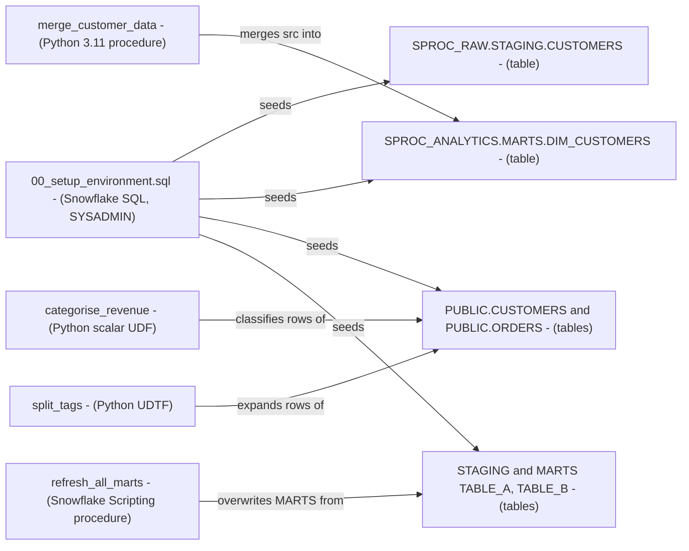

# Snowflake Stored Procedures and UDFs - Architecture and design rationale

*Last updated: 2026-11-07 · commit 2edefc322*

## 1. Purpose and scope

A learning tutorial on extending Snowflake with custom logic: a Python stored procedure that merges data, a Python
scalar UDF, a Python table function (UDTF), and a SQL (Snowflake Scripting) procedure. It is for the author's own
development and for readers learning the differences between these object types. It is not a production framework. The
repository does not say whether it was run against a trial, sandbox or other account; that is not documented.

## 2. How this project was built

This project was built with Claude Code (Anthropic's AI coding assistant) in a complementary role. Elliott Fairhall is
the author and owner: the project is debugged, tested and used by him for learning and development, and the design
decisions below are explained so that they can be understood, questioned and learned from. The scripts are tutorial
material and the repository holds no record of a full run, so this document does not claim one.

## 3. Architecture at a glance

Each object type is demonstrated against its own small table so that no lesson depends on another. Procedures write
(`MERGE`, `INSERT OVERWRITE`); functions only compute values used inside a `SELECT`.

## 4. Learning path

| Step | File                             | What it teaches                                                                           | Why here                                                                            |
| ---- | -------------------------------- | ----------------------------------------------------------------------------------------- | ----------------------------------------------------------------------------------- |
| 0    | `00_setup_environment.sql`       | Seeds one table per lesson, including deliberate edge rows                                | Every example needs data it can change                                              |
| 1    | `01_python_stored_procedure.sql` | `CREATE PROCEDURE ... LANGUAGE PYTHON`, injected `session`, `MERGE` for update-and-insert | Introduces the "run code in Snowflake" idea with the most familiar task (an upsert) |
| 2    | `02_python_scalar_udf.sql`       | Scalar UDF, `NULL` handling, calling in a `SELECT`                                        | The simplest function, contrasting with the procedure                               |
| 3    | `03_python_tabular_udtf.sql`     | Handler class with `process`, `yield`, `TABLE(...)` in `FROM`                             | Extends the scalar idea from one value to many rows                                 |
| 4    | `04_sql_stored_procedure.sql`    | Snowflake Scripting cursor, `EXECUTE IMMEDIATE`, `INSERT OVERWRITE`                       | Shows the SQL-native alternative to step 1                                          |

The tutorial's own order (procedure intro, UDF intro, comparison table, Python procedure, Python UDFs, SQL procedure) is
documented; the reasons above are inferred. The notebook `notebook/Stored_Procedures_UDFs_Tutorial.ipynb` is an empty
shell with zero cells.

## 5. Design rationale

### Seed data with built-in edge cases

- **Why:** the `DIM_CUSTOMERS` target has a row to update (Alice), one to leave alone (Bob) and one the source lacks
  (Charlie), while the source has a new row (David). The UDF table includes a `NULL` revenue ("Unknown Entity"), and the
  UDTF table has one-, two- and three-tag orders. Every branch of each function has a visible row.
- **Gave up:** realism and volume; this shows semantics, not performance.
- **Alternative not taken:** generated data of a realistic size.
- **Evidence:** inferred from the code. Note that Charlie is never deleted by the `MERGE` (it has no
  `WHEN NOT MATCHED BY SOURCE` branch); the seed name "Charlie Delete" suggests a delete was intended or contrasted.

### Python for three objects and SQL for one

- **Why:** the series is Python-leaning, and the SQL Scripting procedure shows the same orchestration role without
  Python's overhead. Table names are passed as parameters so one procedure serves several tables.
- **Gave up:** the tutorial gives no guidance on choosing between languages for performance or cost.
- **Alternative not taken:** the same objects in SQL UDFs, which are often simpler for pure expressions.
- **Evidence:** inferred; the tutorial states that both SQL and Python are supported.

### Table names built into SQL by string concatenation

- **Why (inferred):** it makes the procedures reusable and compact.
- **Gave up:** `merge_customer_data` interpolates `source_table` and `target_table` with an f-string, and
  `refresh_all_marts` concatenates `record.table_name` into `EXECUTE IMMEDIATE`. That is SQL injection exposure if a
  caller is untrusted, and it contradicts the repository's own guidance to use `IDENTIFIER(...)`. Safe here only because
  the caller is the learner.
- **Alternative not taken:** `IDENTIFIER(?)` binding or an allow-list of table names.
- **Evidence:** inferred from the code.

### `refresh_all_marts` overwrites and uses `SELECT *`

- **Why:** a full `INSERT OVERWRITE` per table is the simplest possible "refresh" and needs no key.
- **Gave up:** `INSERT OVERWRITE` replaces target contents; `SELECT *` breaks if the staging and mart column orders
  diverge; the cursor reads `information_schema.tables` for whichever database the session is using, not necessarily
  `ANALYTICS`.
- **Alternative not taken:** explicit column lists and a database-qualified `information_schema`.
- **Evidence:** inferred from the code.

### Safety and cost

- No warehouse, task or schedule is created, so nothing keeps running after the lesson. There is no cleanup script; all
  objects and tables stay.
- Calling the procedures needs a running warehouse for their statements; the size is the session's choice.
- All objects are created with `CREATE OR REPLACE`, which is fine for functions and procedures but also applies to the
  data tables in script 00.

## 6. Quality and testing

No tests or CI. Verification is by running the `SELECT` and `CALL` statements and reading the results. A failure would
show as a Snowflake compilation error or an unexpected row count.

## 7. Constraints, limitations and known gaps

- `scripts/01_python_stored_procedure.sql` had `f"\""` and `"\""` where the tutorial has `f"""` and `"""`, so the Python
  body would not have parsed. Fixed to triple quotes; not run against Snowflake after the change.
- `00_setup_environment.sql` creates `PUBLIC.CUSTOMERS` and `PUBLIC.ORDERS` without choosing a database, so they land in
  whichever database the session uses. Scripts 02 and 03 select from unqualified `customers` and `orders`.
- The setup script now begins with a warning that it drops and recreates these tables (a reset step), and should only be
  run in a scratch account or clean database. Each tutorial now has its own database names (prefix `SPROC_` here), so it
  no longer touches another tutorial's tables (changed 2026-11-07).
- `00_setup_environment.sql` uses `CREATE OR REPLACE TABLE` on `SPROC_RAW.STAGING.CUSTOMERS` and
  `SPROC_ANALYTICS.MARTS.DIM_CUSTOMERS`. The Snowpipe, Streams and Time Travel tutorials create tables of the same names
  with different columns, but in their own prefixed databases, so they no longer collide (changed 2026-11-07).
- `categorise_revenue` has the same name as the Snowpark tutorial's UDF but different tier labels.
- Script 00 seeds `DIM_CUSTOMERS` with `CURRENT_TIMESTAMP()`, which is fine for a one-off setup but not re-runnable
  logic.
- The tutorial says UDFs "cannot execute DDL/DML" and lists an aggregate UDF (UDAF) type; the UDAF is not demonstrated
  and the claims are not verified here. `TODO: verify`
- The empty notebook is shipped in the repository and the README lists it as part of the structure.

## 8. Running and extending

Setup and usage are in the [README](../README.md) and the [tutorial](../Tutorial/STORED_PROCEDURES_UDFS_TUTORIAL.md). To
extend safely: qualify all names, add `USE DATABASE` to the setup, add a cleanup script, and replace string
concatenation with `IDENTIFIER(...)`.

## 9. Rationale (confirmed by the owner)

Confirmed by Elliott Fairhall on 2026-11-07. This reasoning was first reconstructed from the code and commit history;
the owner has since agreed it is correct, so it is now the stated rationale rather than an inference.

- One seed table per lesson was chosen so lessons stay independent and can be run in any order after setup.
- Edge rows (Charlie, the `NULL` revenue, single-tag order) were included on purpose to exercise each branch.
- The SQL procedure is included as a contrast to the Python procedure, not as the preferred approach.
- Dynamic table names were accepted for brevity, knowing they would not be acceptable for untrusted callers.
- The empty notebook is a placeholder for a future hands-on version.
